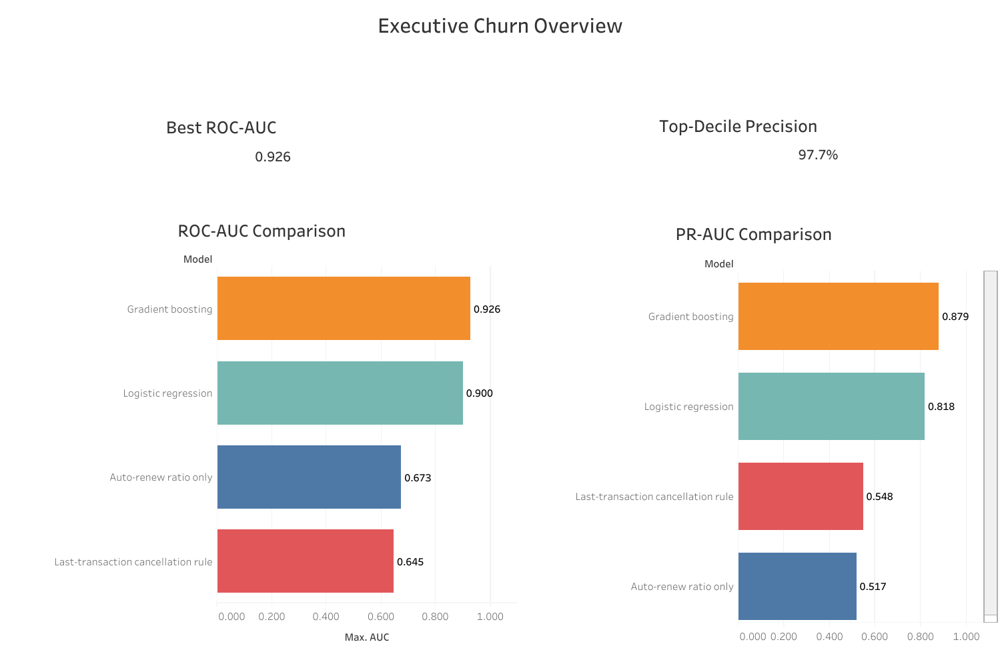
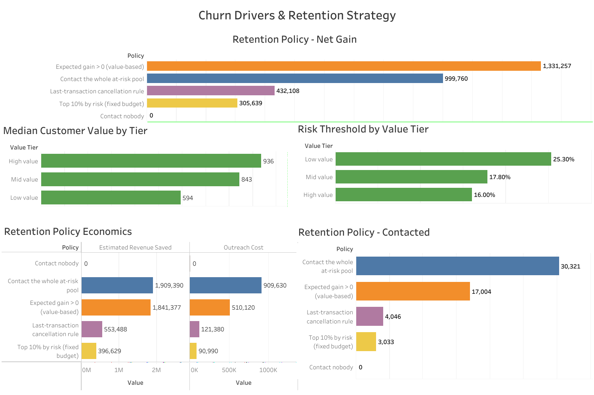

# KKBox Customer Churn Prediction & Retention Analytics

> **End-to-end analytics portfolio project | SQL · DuckDB · Python · scikit-learn · statsmodels · lifelines · Tableau**

## 1. Project Overview

This project builds a customer churn analytics workflow using historical KKBox subscription and transaction data. It combines SQL-based data preparation, customer-level feature engineering, churn classification, model evaluation, exploratory survival analysis, customer-value segmentation, and scenario-based retention-policy analysis.

The goal is to demonstrate how an analyst can move from transactional data to model comparisons and business-facing recommendations. The retention scenarios are hypothetical estimates; they do **not** prove that a campaign causes incremental retention.

## 2. Business Problem

Subscription businesses need to identify customers who may stop renewing, understand which observed behaviors are associated with churn, and prioritize retention outreach when budgets or contact capacity are limited.

**Business questions**
- Can transaction and subscription history help rank customers by churn risk?
- Which baseline and machine-learning models perform best on the defined churn target?
- How much of the at-risk population could a limited outreach campaign cover?
- Which outreach policy appears most attractive under explicit cost and customer-value assumptions?
- What must be validated before using this analysis in a live retention campaign?

## 3. Key Results at a Glance

These are the latest saved notebook results. Re-run the notebook and verify that the split, target, and evaluation code remain unchanged before presenting them as final.

| Item | Saved result |
|---|---:|
| Customer-level model table | 987,567 customers |
| Classifier at-risk pool | 121,281 customers |
| Held-out test set | 30,320 customers |
| Churn prevalence in held-out test set | 38.8% |
| Best reported ROC-AUC | 0.9266 — Gradient Boosting |
| Best reported PR-AUC | 0.8792 — Gradient Boosting |
| Gradient Boosting precision among top 10% risk scores | 97.89% |
| Gradient Boosting recall among top 10% risk scores | 25.24% |
| Highest estimated net gain in saved scenarios | ~NTD 1.323 million — value-based policy |
| Exploratory survival cohort | 121,247 customers |
| Exploratory proxy-time held-out C-index | 0.8963 |

**Interpretation caution:** classification metrics depend on the historical target and feature definitions; some cancellation/recency features may be close to the churn label. Retention value is a scenario estimate, not measured campaign ROI. The survival C-index is based on proxy event times and is not directly comparable to a conventional time-to-event benchmark.

## 4. Dataset

The project uses historical KKBox churn-prediction data, including member and transaction/renewal history. The workflow aggregates records to customer level rather than treating each transaction as an independent customer.

- **Feature cutoff:** 28 February 2017
- **Label resolution cutoff:** 31 March 2017
- **Classification target:** official Kaggle churn label (`is_churn_official`)
- **Additional label check:** constructed 30-day renewal-confirmation label, used for comparison/quality checks rather than as a model feature
- **Raw data:** not included in this repository; obtain them from the authorized competition/source location.

Confirm the exact files downloaded and used by the notebook before reproducing results.

## 5. Methodology

### Data preparation and label construction
1. Load and stage the available member and transaction data.
2. Apply a fixed feature cutoff so features use information available by the chosen date.
3. Construct and inspect a 30-day renewal-confirmation label using the resolution window.
4. Aggregate transaction history into customer-level features.
5. Check date ranges, missingness, duplicate/overlapping records, label prevalence, and agreement between label definitions.
6. Keep target/label columns out of the model feature set.

### Exploratory analysis and feature engineering
Explore renewal and cancellation patterns, transaction frequency, recency, auto-renew behavior, plan duration, and customer tenure. Review features that could create target proximity or leakage-like behavior. Feature importance is predictive association, not evidence of causation.

### Classification and evaluation
Compare simple baselines with machine-learning models on a held-out test set. The main business use is ranking customers for a constrained contact budget, not only assigning a hard churn/no-churn label.

### Retention-policy analysis
Translate risk scores and customer-value estimates into outreach policies. Compare contact-all, rule-based, top-risk, and value-based policies using assumed contact costs and customer values. These scenarios support prioritization discussions; they do not establish causal campaign lift.

### Exploratory survival analysis
A separate section demonstrates Kaplan–Meier estimation, a log-rank test, Cox proportional-hazards regression, hazard ratios, VIF checks, Schoenfeld-residual-based proportional-hazards diagnostics, and a held-out concordance index. Event time is a proxy based on expiry/label information, not an observed individual cancellation timestamp. Treat this section as a methods demonstration, not a definitive time-to-churn study.

## 6. Project Architecture

```text
KKBox raw data
     |
     v
SQL staging and data-quality checks
     |
     v
Label construction + customer-level feature aggregation
     |
     v
Customer model table
     |
     +------------------------------+
     |                              |
     v                              v
Churn classification          Exploratory survival analysis
     |                              |
     v                              v
Held-out model evaluation     KM / log-rank / Cox / diagnostics
     |
     v
Risk ranking + customer-value segmentation
     |
     v
Scenario-based retention-policy economics
     |
     v
Approved aggregate exports --> Tableau dashboards
```

This diagram represents the intended analytical flow. Exact SQL filenames and export artifacts should match the files actually committed to the repository.

## 7. Project Pipeline

1. **Ingest and stage:** load available source tables and standardize fields.
2. **Validate data:** inspect missingness, duplicates, date boundaries, target prevalence, and source-table overlap.
3. **Build labels:** create the official classification target and a separate renewal-confirmation check.
4. **Engineer features:** aggregate transaction, cancellation, auto-renewal, recency, plan-duration, and tenure signals.
5. **Create the model table:** enforce feature/label separation and the feature cutoff.
6. **Train and compare:** fit baseline rules, logistic regression, and gradient boosting.
7. **Evaluate:** report ROC-AUC, PR-AUC, top-decile precision/recall, and lift on held-out data.
8. **Interpret:** examine odds ratios and permutation importance where available; review multicollinearity and target proximity.
9. **Model retention policies:** compare outreach strategies and customer-value thresholds under explicit assumptions.
10. **Explore survival methods:** run Kaplan–Meier, log-rank, Cox regression, and diagnostics with proxy-time caveats.
11. **Export safely:** allow-list aggregate outputs and check for customer identifiers before sharing.
12. **Visualize:** connect approved aggregate CSVs to Tableau.

## 8. Tech Stack

| Technology | Use |
|---|---|
| SQL | Staging, label construction, feature aggregation, data checks |
| DuckDB | Local analytical SQL workflow |
| Python | Analysis and workflow orchestration |
| Pandas / NumPy | Data manipulation and numerical operations |
| scikit-learn | Classification models and evaluation utilities |
| statsmodels | Statistical diagnostics such as VIF |
| lifelines | Kaplan–Meier, log-rank, Cox regression, survival diagnostics |
| Matplotlib | Exploratory plots |
| Tableau | Planned portfolio dashboards using approved aggregate exports |
| Jupyter / Google Colab | Notebook execution environment |

## 9. Models

| Model | Role |
|---|---|
| Last transaction was a cancellation | Simple rule-based benchmark |
| Auto-renew ratio only | Single-signal benchmark |
| Logistic Regression | Interpretable classification baseline |
| Gradient Boosting | Nonlinear classification comparison model |
| Kaplan–Meier estimator | Exploratory survival curve estimation |
| Log-rank test | Compare survival curves across groups |
| Cox proportional-hazards model | Explore covariate associations with proxy-time outcomes |

Survival methods are separate from the churn classifier and should not be compared using ROC-AUC/PR-AUC.

## 10. Evaluation Metrics

- **ROC-AUC:** ranking/discrimination across classification thresholds.
- **PR-AUC:** summarizes the precision–recall trade-off.
- **Precision @ top 10%:** fraction of the top-risk decile labeled churn.
- **Recall @ top 10%:** fraction of all labeled churners captured in the top-risk decile.
- **Lift @ top 10%:** top-decile precision relative to overall test-set churn prevalence.
- **C-index (survival):** ranking concordance for the constructed proxy-time outcome; interpretation is limited by proxy event times.
- **VIF and proportional-hazards diagnostics:** assess multicollinearity and the Cox model's proportional-hazards assumption.

## 11. Model Comparison

Saved classification metrics:

| Model | ROC-AUC | PR-AUC | Precision @ top 10% | Recall @ top 10% | Lift @ top 10% |
|---|---:|---:|---:|---:|---:|
| Rule: last transaction was a cancel | 0.6474 | 0.5525 | 0.9133 | 0.2355 | 2.3546 |
| Auto-renew ratio only | 0.6713 | 0.5157 | 0.5703 | 0.1470 | 1.4702 |
| Logistic Regression | 0.9010 | 0.8245 | 0.9218 | 0.2377 | 2.3767 |
| Gradient Boosting | **0.9266** | **0.8792** | **0.9789** | **0.2524** | **2.5238** |

**Finding:** Gradient Boosting leads on all five reported metrics in this saved run. At a top-10% contact capacity, it captures about one quarter of labeled churners while the selected decile has high precision. High precision can be inflated by features closely tied to the label; validate feature timing and leakage risk before prospective use.

## 12. Results and Key Findings

- Gradient Boosting has the strongest reported held-out classification performance in the saved comparison.
- Logistic Regression substantially outperforms the simple baselines and provides an interpretable benchmark.
- The top 10% risk group offers a way to focus outreach when contact capacity is limited, but it does not capture every churner.
- The saved value-based retention scenario has the highest estimated net gain among compared policies under configured assumptions.
- The survival workflow has a large constructed cohort, but event times are proxies rather than observed cancellation dates.
- The saved Schoenfeld-residual-based test flagged all nine fitted Cox predictors at the 5% level; the proportional-hazards assumption is not supported by those diagnostics in that run.
- Maximum reported VIF was 7.39 for `n_cancel_last_90d` in the saved nine-predictor Cox model.
- Results are historical and depend on label construction, feature timing, test split, and business-scenario assumptions.

## 13. Business Impact and Retention Economics

The saved scenario table reports the following policy comparison. Values are estimates under the notebook's assumptions, not measured causal outcomes.

| Policy | Customers contacted | Precision | Recall | Est. revenue saved (NTD) | Contact cost (NTD) | Est. net gain (NTD) |
|---|---:|---:|---:|---:|---:|---:|
| Contact nobody | 0 | — | 0.000 | 0 | 0 | 0 |
| Contact all at-risk customers | 30,320 | 0.388 | 1.000 | 1,907,113 | 909,600 | 997,513 |
| Last transaction was a cancel | 4,046 | 0.912 | 0.314 | 558,536 | 121,380 | 437,156 |
| Top 10% risk | 3,032 | 0.922 | 0.238 | 400,221 | 90,960 | 309,261 |
| Value-based policy | 16,814 | 0.653 | 0.934 | 1,827,346 | 504,420 | **1,322,926** |

**Business interpretation:** under the saved assumptions, the value-based policy balances customer value and outreach cost and reports the highest estimated net gain (~NTD 1.323 million). The top-decile policy is more selective and cheaper, but reaches a smaller share of churners.

These estimates depend on assumed contact cost, retention success, customer value/revenue horizon, and the definition of revenue saved. A randomized holdout or other credible causal design is needed to estimate incremental campaign impact.

## 14. Business Recommendations

1. **Use risk ranking as a prioritization aid, not an automatic action.** Start with a pilot and human-reviewed rules.
2. **Choose the policy based on constraints.** A top-decile policy suits limited contact capacity; a value-based policy may be attractive when value estimates and costs are credible.
3. **Validate feature timing.** Exclude signals unavailable at prediction time and review cancellation/renewal fields for target proximity.
4. **Run a controlled retention experiment.** Compare treatment and holdout groups; measure incremental renewal, margin, and contact cost.
5. **Monitor segments.** Track precision, recall, contact rate, retention lift, and net contribution over time.
6. **Revalidate before deployment.** The dataset is historical; use a more recent period if data become available.
7. **Keep survival conclusions exploratory.** Use genuine event timestamps and adequate follow-up before making time-to-churn decisions.

## 15. Tableau Dashboard

The planned Tableau workbook should use **approved aggregate CSVs only** and contain four views:

1. **Executive Overview:** test-set churn prevalence, model ROC-AUC/PR-AUC, top-decile precision/recall, and headline findings.
2. **Model Performance:** compare ROC-AUC, PR-AUC, precision, recall, and lift across the four classifiers/baselines.
3. **Drivers & Segments:** show validated feature-importance/segment summaries and label survival findings as exploratory.
4. **Retention Economics:** compare policies by customers contacted, estimated revenue saved, contact cost, and estimated net gain.

Tableau should be described as completed only after the workbook has actually been built and screenshots or the packaged workbook are committed. Until then, this section is a dashboard plan. Do not publish customer-level predictions or exports containing `msno`.

## 16. Limitations

- **Historical data:** patterns from 2017 may not generalize to current subscription behavior.
- **Label definition:** the official target and 30-day renewal-confirmation check measure churn through different operational definitions.
- **Potential target proximity:** cancellation and recency features may be closely related to the label and could overstate prospective performance.
- **Evaluation comparability:** verify every model uses the same held-out customers, label, and evaluation code.
- **Scenario assumptions:** retention value, contact cost, and saved revenue are not experimentally measured.
- **Survival event time:** `last_expire` is a proxy, not an observed cancellation timestamp.
- **Survival follow-up/censoring:** the observation window is short; complete-window selection may introduce bias, and non-informative censoring is not established.
- **Cox diagnostics:** all nine predictors were flagged by the proportional-hazards test in the saved run; interpret hazard ratios cautiously.
- **Data coverage:** transaction source tables can have different coverage and overlapping records.
- **Privacy:** raw data, customer identifiers, and customer-level predictions must not be committed publicly.

## 17. Repository Structure

Adapt this tree to files that actually exist in the repository; do not commit empty folders or claim unbuilt deliverables.

```text
kkbox-churn-project/
├── README.md
├── kkbox_churn_project_portfolio_final_section10_updated.ipynb
├── sql/
│   ├── 01_load.sql
│   ├── 02_quality_checks.sql
│   ├── 03_staging.sql
│   ├── 04_labels.sql
│   ├── 05_features.sql
│   └── 06_model_table.sql
├── dashboard_exports_public/      # approved aggregate CSVs only
└── dashboards/
    └── screenshots/               # add after dashboards are built
```

The SQL filenames are a suggested structure based on the current workflow; align them with the actual committed scripts. Do not include raw KKBox data, credentials, `msno`, or row-level predictions in a public repository.

## 18. Outputs

| Output | Purpose | Sharing status |
|---|---|---|
| `final_model_comparison.csv` | Classification model metrics | Share only after aggregate/privacy review |
| `retention_policy_comparison.csv` | Scenario-based policy economics | Share only after aggregate/privacy review |
| `customer_value_tiers.csv` | Customer-value segment summary | Confirm no identifiers or row-level records before sharing |
| `permutation_importance.csv` | Feature-importance summary, if produced | Include only if generated and checked |
| Tableau workbook / screenshots | Business-facing visualization | Add after actual construction and validation |
| Updated notebook | Reproducible workflow and documented analysis | Review outputs for identifiers before publishing |

The notebook's export section may skip an output if its source dataframe is unavailable. Confirm actual files after running the notebook; this README does not imply every listed artifact already exists.

## 19. Dashboard Pages

### 1. Executive Churn Overview

Compares the forecasting models using WMAPE, MAE, RMSE, and model ranking.

**Primary question:**  
> How effectively can we predict customer churn, and which model performs best?

Gradient Boosting achieved the highest observed performance in the current comparison, with a ROC-AUC of 0.926 and PR-AUC of 0.879. Logistic Regression is a competitive alternative, with a ROC-AUC of 0.900 and PR-AUC of 0.818. The top-decile precision KPI shows 97.7%, but this should be verified against the selected model and its evaluation protocol before reporting it as the model's performance.

View the [live interactive dashboard on Tableau Public](https://public.tableau.com/app/profile/maanya.saxena/viz/CustomerChurnAnalysis_17924841151790/ExecutiveChurnOverview).

### 2. Churn Drivers & Retention Strategy

Shows service-level feasibility, inventory cost, holding vs. stockout cost,
and the realized cost impact of the optimized allocation.

**Primary question:**  
> Which retention policy offers the best estimated economic return while reducing outreach workload?

The value-based retention policy reports the highest estimated net gain of 1,331,257 while contacting 17,004 customers, approximately 44% fewer than the 30,321 customers contacted under the full at-risk-pool policy. It reports outreach cost of 510,120 and estimated revenue saved of 1,841,377. These are modelled estimates based on the project's assumptions, not experimentally confirmed retention outcomes.
View the [live interactive dashboard on Tableau Public](https://public.tableau.com/app/profile/maanya.saxena/viz/SurvivalAnalysis_17924939558530/ChurnDriversRetentionStrategy?publish=yes).


## 20. Skills Demonstrated

- SQL data preparation and feature engineering
- Data-quality checks and label validation
- Exploratory data analysis
- Python data wrangling with Pandas and NumPy
- Binary classification and model benchmarking
- ROC-AUC, PR-AUC, precision, recall, and lift evaluation
- Model interpretation and leakage/target-proximity review
- Statistical diagnostics and multicollinearity assessment
- Survival-analysis methods and assumption checking
- Customer segmentation and value-based prioritization
- Scenario modeling and business trade-off analysis
- Translating analytical outputs into retention recommendations
- Dashboard planning, aggregate export, and privacy-aware reporting
- Communicating assumptions, limitations, and uncertainty


